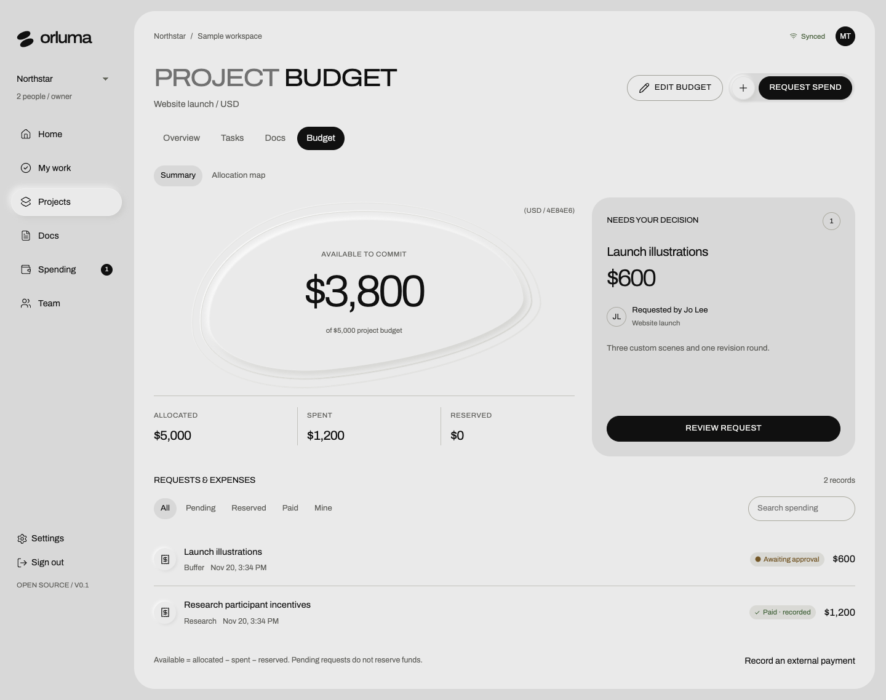

# Orluma

A shared place to move things forward. An open-source workspace for small teams, with projects, tasks, documents and spending in context.



**v0.1.0 · early self-hosted release.** You own the installation and the data. No per-seat billing, hosted account service, analytics or required external API. Hosting and backups are the operator’s responsibility.

## What works

- Multiple workspaces with invitations and owner, admin, member and viewer roles.
- Projects with goals, milestones, task lists and boards, assignments and comments.
- Markdown documents, explicit saves and version conflict recovery that keeps your draft.
- Project budgets and allocation maps, spending requests with a separate approver, payment records and an activity trail.
- Updates between teammates through server-sent events, with refresh on focus and a polling fallback.
- Persistent SQLite data and sessions, workspace JSON export, online database backup and operator password recovery.
- A responsive Stone & Fog interface, local fonts, reduced-motion support and keyboard-accessible controls.

All members of a workspace can see its projects, documents and financial records. There are no private projects or field-level finance permissions in this release. Use separate workspaces for separate access boundaries.

## Run locally

Use **Node.js 24.x** (tested on 24.14.1) and npm.

```sh
git clone https://github.com/mariiateslia/orluma.git
cd orluma
npm ci
cp .env.example .env
npm run build
npm start
```

Open **http://localhost:3000**. Create your account, then your workspace. You can start empty or opt into the clearly labeled fictional Website launch sample.

The first account bootstraps the installation. Register it locally before exposing the instance to other people. Later accounts require an invitation by default.

In **Team → Invite teammate**, create an invitation and share its link with that person. Links are bound to an email, expire after seven days and work once. Orluma does not send invitation email. Invite another admin if you want to try the approval flow: you cannot approve your own spending.

`npm start`, `npm run backup` and `npm run reset-password` load `.env` automatically. Data lives in `data/orluma.sqlite` by default and survives process restarts. Do not commit this directory.

For development:

```sh
npm run dev
```

Open http://localhost:5173. Vite proxies `/api` to the Node server on port 3000. Use the production build when testing the production security headers.

## Run with Docker Compose

```sh
git clone https://github.com/mariiateslia/orluma.git
cd orluma
cp .env.example .env
docker compose up --build -d
```

Open http://localhost:3000 and bootstrap the first account. Compose binds the app to the host’s loopback interface and keeps SQLite in a named volume. `docker compose down` preserves that data; **`docker compose down -v` deletes it**.

For teammates to connect, run one shared server with a persistent disk and an HTTPS reverse proxy. Set `APP_URL` to its exact public origin, then restart. A fork of the repository creates a separate codebase; it does not connect people to the same workspace. All teammates use the URL of the same installation.

See [self-hosting and operations](docs/SELF_HOSTING.md) for proxy, backups, restore and recovery instructions.

## Roles

| Capability                                                   | Owner | Admin | Member | Viewer |
| ------------------------------------------------------------ | ----- | ----- | ------ | ------ |
| Read the workspace, including spending                       | Yes   | Yes   | Yes    | Yes    |
| Tasks, docs, comments and spending requests                  | Yes   | Yes   | Yes    | —      |
| Record payment for their approved request                    | Yes   | Yes   | Yes    | —      |
| Create projects, manage budgets and record external payments | Yes   | Yes   | —      | —      |
| Review a request assigned to them, from another person       | Yes   | Yes   | —      | —      |
| Export workspace / invite members and viewers                | Yes   | Yes   | —      | —      |
| Invite admins / change roles / remove other people           | Yes   | —     | —      | —      |

An account can create its own separate workspaces. Roles apply independently in each workspace. The last owner cannot leave or demote themselves. Resolve pending approvals before removing or demoting their assigned approver.

## How money is represented

Each project has one currency: USD, EUR, GBP, CAD or AUD. The app stores integer cents and never combines currencies into one total.

```text
Available to commit = project budget − recorded payments − approved commitments
```

A pending request reserves nothing. Approval reserves its amount atomically. Recording that approved request as paid moves the same amount from reserved to spent, once. Voiding a payment keeps its history and releases its effect on spent totals. Actual external payments can exceed the budget; the app displays the resulting shortfall. New approvals cannot exceed available funds.

Category allocations organize the project budget; they are not separate enforced spending limits. Contour rings are decorative, not forecasts. Orluma records decisions and payments; it does not connect to banks, issue cards, transfer money or provide accounting compliance.

## Collaboration and privacy

Changes are saved on your server, not just in one browser. Document saves use versions: if someone saved first, the app preserves your draft and lets you compare, merge or save a copy. It does not merge character-level edits live. Unsaved drafts remain only in the current tab; closing it discards them after the browser warning.

Passwords are hashed with scrypt. Sessions use hashed opaque tokens and HttpOnly cookies, with Secure cookies for HTTPS origins. Workspace access is checked by the server on reads, mutations, exports and event streams. Removing someone revokes future access; it cannot erase information they already viewed or downloaded.

The application makes no analytics or AI requests. Fonts and artwork ship locally. Team content goes to the server you operate. Your hosting provider and reverse proxy may retain technical logs. Database backups contain private team and authentication data; treat them accordingly.

This is an early release with tests, not an independently audited enterprise service. It has no SSO, MFA, attachments, offline editing, automated email, automatic backups or account deletion UI. Workspace JSON export is for portability and inspection; full restoration uses a database backup. See [architecture](docs/ARCHITECTURE.md).

## Verify and contribute

```sh
npm test
npm run build
npx playwright install chromium
CI=1 npm run test:e2e
npm run format:check
```

Without `CI=1`, the browser test uses an installed Google Chrome. It creates two isolated browser sessions and a temporary database; it never uses your normal app data. CI also builds the container and checks persistence across a container restart.

Fork the repository, create a branch and open a pull request. See [CONTRIBUTING.md](CONTRIBUTING.md) and [SECURITY.md](SECURITY.md). No third-party paid service is needed to develop the app.

## License and credits

Code is [MIT](LICENSE). Original Orluma artwork is included for reuse with the app; see [asset and dependency credits](THIRD_PARTY_NOTICES.md). The reference images used during design exploration are not distributed in this repository. Orluma is an independent project, not a fork of Huly, Asana, Notion or Ramp.
